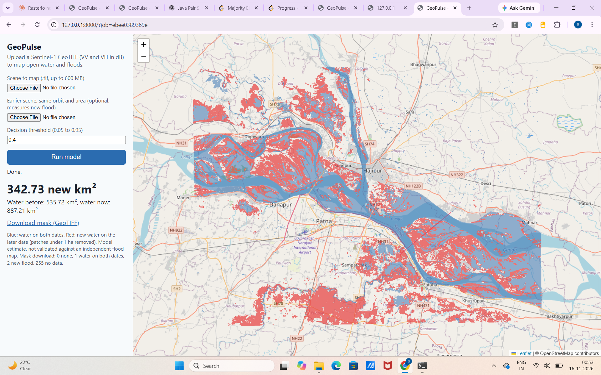

# GeoPulse

Flood mapping from Sentinel-1 SAR radar imagery. A U-Net (PyTorch) is trained on the Sen1Floods11
hand-labelled set, wrapped in a FastAPI service with a Leaflet map page, and applied to the
September 2026 floods around Patna, Bihar using scenes pulled from Google Earth Engine.

*Blue: water on 28 Aug 2026. Red: new water on 9 Sep 2026 (model estimate, patches under 1 ha removed).*

## What it does

- Trains a U-Net on VV and VH backscatter (dB) to separate water from non-water.
- Runs on scenes of any size by cutting them into overlapping 512x512 tiles and blending the results.
- Compares an earlier and a later scene from the same orbit to measure **new** water, which is the flood.
- Serves this through a job-based API (upload, poll, download a georeferenced mask) and a map page.

## Results

Pooled over valid pixels, decision threshold 0.40 (chosen on the validation split before the
test split was used). Single training run, seed 42, 30 epochs, flips/rotations as augmentation.

| Split | Tiles | Precision | Recall | Dice | IoU |
|---|---|---|---|---|---|
| Validation | 86 | 0.777 | 0.772 | 0.774 | 0.632 |
| Test | 88 | 0.772 | 0.807 | 0.789 | 0.652 |
| Bolivia (held-out event) | 15 | 0.851 | 0.770 | 0.808 | 0.678 |

Tiles counts only tiles with at least one valid label pixel (the test split has 90 tiles, 2 of which
have none; the validation split has 89, 3 of which have none; the Bolivia count was not checked).

The best threshold differs between splits (0.55 on test, 0.20 on Bolivia), so the threshold should
not be assumed to transfer to a new event or region.

Training comparison (validation, per-tile mean Dice, single seed, so differences are within noise):

| Run | Best Dice | Mean of last 5 epochs |
|---|---|---|
| Baseline | 0.523 | 0.509 |
| + flips/rotations | 0.521 | 0.511 |
| + flips/rotations + VV-VH channel | 0.528 | 0.466 (unstable) |

### Patna, September 2026 (Sentinel-1 orbit 85, 2,747 km2 area)

| Date | Water found by model | New water vs 28 Aug (cleaned) |
|---|---|---|
| 28 Aug | 535.7 km2 | baseline |
| 9 Sep | 887.2 km2 | 342.7 km2 |
| 21 Sep | 568.1 km2 | 98.0 km2 |

A second pair from orbit 19 (24 Aug to 5 Sep) gave 244.8 km2 of new water over a slightly smaller
footprint. Because the orbits view the ground differently, the two pairs should not be compared directly.

### Per-region results on the test split (threshold 0.40)

| Region | Tiles | Precision | Recall | Dice | IoU |
|---|---|---|---|---|---|
| India | 14 | 0.843 | 0.831 | 0.837 | 0.720 |
| USA | 14 | 0.585 | 0.828 | 0.686 | 0.522 |
| Paraguay | 13 | 0.615 | 0.842 | 0.711 | 0.552 |
| Ghana | 10 | 0.881 | 0.589 | 0.706 | 0.545 |
| Sri-Lanka | 9 | 0.920 | 0.920 | 0.920 | 0.852 |
| Mekong | 6 | 0.911 | 0.930 | 0.921 | 0.853 |
| Pakistan | 6 | 0.317 | 0.357 | 0.336 | 0.202 |
| Somalia | 6 | 0.810 | 0.589 | 0.682 | 0.517 |
| Spain | 6 | 0.785 | 0.901 | 0.839 | 0.723 |
| Nigeria | 4 | 0.917 | 0.961 | 0.939 | 0.884 |
| All (pooled) | 88 | 0.772 | 0.807 | 0.789 | 0.652 |

Per-tile Dice (tiles that contain water, n=82): mean 0.530, median 0.587. The pooled figure is much higher
because large water bodies dominate it, so typical tiles score lower than the headline number.
Four of the five worst tiles score a Dice of 0 (Ghana, Paraguay, two in Somalia). USA and Paraguay show
over-prediction (low precision), Ghana and Somalia under-prediction (low recall), and Pakistan is weak on
both. Regions with 4 to 6 tiles give noisy estimates.

## Limitations

- **The Patna areas are model estimates.** I found no independent flood-extent map for this event to
  check them against.
- **Radar sees water, not flooding.** The model maps all open water, including rivers in their normal
  channels. New water between two dates is a better flood measure, but wet fields and other changes
  can also alter radar brightness.
- **Passes are 12 days apart per orbit**, so the true flood maximum may fall between scenes.
- **Single training run.** No error bars. Differences of a few hundredths between settings are not
  meaningful.
- **Bolivia is one event with 15 tiles.** It shows no drop in accuracy there; it does not show that the
  model generalises across regions. Published work reports larger drops on held-out events.
- The validation and test tiles come from the same flood events as the training tiles.
- Pooled metrics let large water bodies dominate; per-tile accuracy is lower (see the per-region table).
- The cause of the failures on the worst tiles has not been investigated yet.

## Setup

    python3 -m venv .venv
    source .venv/bin/activate
    pip install -r requirements.txt

Model weights and data are not in the repository. Download the data and train:

    python download_data.py --splits train valid test bolivia
    python train.py --epochs 30 --batch_size 8 --seed 42 --num_workers 2 --augment --out_dir runs/aug

Evaluate on a split at a given threshold:

    python sweep_threshold.py --weights runs/aug/best.pth --csv data/raw/sen1floods11/metadata/test_data.csv

## Run the app

    python -m uvicorn backend.main:app --port 8000

Open http://127.0.0.1:8000, upload a Sentinel-1 GeoTIFF (VV band 1, VH band 2, in dB, projected CRS),
optionally with an earlier scene from the same orbit and grid to measure new water. A scene takes a
few minutes on a CPU. The server has no login or rate limits, so run it locally only.

## Getting scenes from Google Earth Engine

Needs a registered Earth Engine project. `list_passes.py` lists Sentinel-1 passes over a point,
`check_aoi.py` checks coverage of an area for a given orbit and date, and `export_scene.py` downloads
a scene as a GeoTIFF. Compare scenes with `compare_scenes.py` and `clean_change.py`.

## Data and references

Sen1Floods11 (Bonafilia et al., 2020), Sentinel-1 data from Copernicus via Google Earth Engine.
